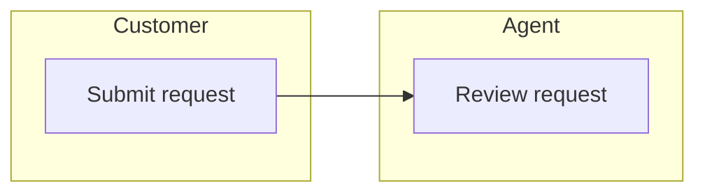

# Diagram selection (Stage I, section 2)

Use Mermaid. Pick one type. State the reason in one line.

| PRD shape | Diagram | Mermaid start |
|---|---|---|
| One user journey or one linear flow | Flowchart | `flowchart LR` |
| Many actors who hand work to each other | Swimlane: flowchart with one subgraph per actor | `flowchart LR` plus `subgraph` |
| Interaction between systems or services | Sequence diagram | `sequenceDiagram` |
| Objects that change state (order, request, case) | State diagram | `stateDiagram-v2` |

## Rules

- Use short labels. Use 15 nodes or fewer.
- If the PRD needs more, show the main flow. Move detail to section 4.
- Use the same names as in the glossary (section 3).
- Add 3 to 5 lines under the diagram that explain how to read it.
- Do not apply STE to Mermaid syntax. Apply it to the labels and the lines under the diagram.
- Quote labels that hold brackets, colons, or parentheses.

## Example: swimlane

## Stage II use

Use the same rules for the module diagram only if `breakdown-guide.md` has no rule for it.
